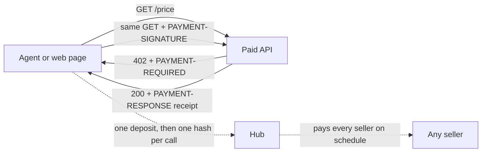

# paymesh

[](https://github.com/bytes-as/paymesh/actions/workflows/check.yml)

**Pay-per-call for APIs, built for AI agents.** An agent calls a paid endpoint, gets
`402 Payment Required`, pays inside its next request and gets the answer, in milliseconds.
No accounts, no cards, no API keys, no subscriptions. It speaks [x402 v2](https://github.com/x402-foundation/x402),
the open standard for HTTP payments, and is checked against its reference SDK.

## Why

Agents buy data and compute one call at a time, from sellers they have never met. Accounts
and monthly plans don't fit that, and a blockchain transaction per call is too slow and too
expensive for a fraction of a cent. paymesh gives each call a payment that costs about as
much as the call itself:



* **On-chain**: one signed transaction per call, sent in the header, settled by the seller.
* **Payment channel**: one deposit, then every call carries the next word of a hash chain.
  The seller checks it with a few hashes; nothing touches the chain until the channel closes.
* **Hub**: one deposit pays *any* seller on the network. The hub pays each seller on a
  schedule while the channel stays open.

It works from Python (`paymesh_client.py`), from a browser page (`js/paymesh.js`, no
dependencies), for any WSGI API (`paymesh_seller.py`), and as an x402 facilitator for
servers that run no paymesh code at all.

## In three numbers

* **Under a millisecond** per paid call through a channel (median 0.4–0.7 ms, 1,300–2,500
  calls/s from one client on one machine); 3–7 ms paying on-chain ([BENCHMARKS.md](BENCHMARKS.md)).
* **5 bytes** of chain per channel call, against about 5,300 bytes per on-chain call.
* **52 of 52 attacks refused**: forged signatures, double payments, replays, refund races,
  cross-site minting. 137 tests, among them a node killed in the middle of a payout and a fuzz
  test of thousands of random steps with crashes ([SECURITY.md](SECURITY.md)).

## Why its own chain?

paymesh settles on a small local chain (Python stdlib only, one node), so every rule can be
attacked, crashed and fuzzed in one process and anyone can run the whole thing in five
minutes. It also signs with hash-based one-time keys (WOTS, the
building block of SPHINCS+), a kind of signature believed to resist quantum computers; this
implementation has not been audited. The parts that matter for agents don't depend on that chain: the
x402 scheme, payment channels, the hub with its payouts, the facilitator and the clients. The
next step is to settle channel opens, payouts and closes on a public chain (an EVM contract
holding USDC) and keep everything else as it is. What it is not: there is no consensus. The
single node mines alone, "mining" is light block hashing, and PMX is play money from a faucet.

| who | trusts | protected by |
|---|---|---|
| buyer | nothing it hasn't signed | a seller can only claim words the buyer revealed; unspent deposit comes back |
| seller, direct channel | no one | it closes with its best word whenever it likes, even during a buyer's 10-minute refund window |
| seller, via the hub | the hub, between payouts | payouts every 60 s or 50 PMX owed; each one recorded on chain, never paid twice |
| everyone | the single node (miner, faucet, hub) | open code, a chain anyone can replay and check (`chain.json`) |

Protocol details: [PROTOCOL.md](PROTOCOL.md). Interop with the reference x402 SDK:
`interop/x402_reference.py`. CI (`.github/workflows/check.yml`) runs `check.py` on Ubuntu and
Windows with Python 3.10 and 3.13.

## Quickstart (5 minutes)

You need Python 3.10 or newer and nothing else: no packages, no accounts, no real money.
Commands use `py -3` (Windows); on macOS and Linux write `python3` instead.

**1. Get it and start a node** (a local chain, a paid API on :8402, an explorer on :8403):

```
git clone https://github.com/bytes-as/paymesh
cd paymesh
py -3 paymesh.py start
```

Open http://127.0.0.1:8403 to watch blocks, payments and channels arrive.

**2. Start a second seller** in another terminal, in the same folder: an API that runs no
paymesh code of its own and charges 3 PMX per `/forecast` through the node.

```
py -3 examples/weather_api.py
```

**3. Pay from Python**: one call paid on-chain, three through a payment channel, then one
deposit with the node's hub paying both sellers:

```
py -3 examples/quickstart.py
```

**4. Pay from a browser**: serve the demo page on another origin and open it:

```
py -3 -m http.server 8410 --directory js
```

Open http://localhost:8410/demo.html, copy the wallet address the page shows, and fund it
with test coins from a third terminal:

```
py -3 wallet.py faucet <the address>
```

Then click the blue buttons (a tx, a channel, the hub paying both sellers; together they
need 78 of the faucet's 100 PMX). The red ones show that a page on another site can't mint
coins or read accounts. A payment refused after signing (say, too little money) locks the
page's wallet, so that it never reuses a one-time key a seller has seen: click "New wallet"
and fund that one. Tested in Edge; any
current browser should do (Firefox: open the same URL).

**5. Stop**: Ctrl+C the weather seller and the page server, then `py -3 paymesh.py stop`.
`start` detaches the node on every OS (Linux/macOS: its own session, so closing the terminal
doesn't stop it) and keeps its pid in `paymesh.pid` next to the chain; `stop` ends it cleanly.

Ports taken? Set `PAYMESH_API_PORT`, `PAYMESH_EXPLORER_PORT` and `WEATHER_PORT` in each
terminal, and open the page as `demo.html?api=http://127.0.0.1:<api port>&shop=http://127.0.0.1:<weather port>`.
The chain and wallets live in this folder (`chain.json`, `wallets/`); delete them to start over.

More: `py -3 buyer_agent.py` (an agent that discovers prices, pays and logs each payment),
`py -3 examples/payout_demo.py` (sellers paid on schedule), `py -3 paymesh.py status`.

## Use it from an agent

```python
from paymesh_client import Client
api = Client("http://127.0.0.1:8402", wallet="my-agent")
api.faucet()                              # demo money: 100 PMX
status, data = api.get("/premium/price")  # pays on-chain by itself
api.last_receipt()                        # the PAYMENT-RESPONSE: success, txid, payer
api.open_channel(ticks=500)               # lock 500 PMX once
status, data = api.get("/premium/price")  # now paid from the channel
api.close_channel()                       # settle; the unspent rest comes back

api.open_hub(ticks=500)                   # or: one deposit with the node's hub...
api.get("/premium/price")                 # ...pays this API
api.get("http://127.0.0.1:8404/forecast") # ...and any other seller on that node
api.close_channel()                       # one tx pays every seller its share
```

The client learns each route's price from its first 402, keeps one HTTP
connection alive, and saves its channel so it can resume after a restart.

### From a web page (`js/paymesh.js`)

One dependency-free JavaScript file pays an x402 route from a browser (or Node.js). It
signs WOTS v2 payments byte for byte as `wallets.py` does (`tests/test_js_client.py`
compares them with Node.js):

```html
<script src="paymesh.js"></script>
<script>
  const wallet = Paymesh.Wallet.create();   // fund wallet.address from a script or the CLI
  const api = new Paymesh.Client("http://127.0.0.1:8402", wallet, w => localStorage.setItem("w", JSON.stringify(w)));
  api.get("/premium/price").then(r => console.log(r.status, r.body, r.receipt));
</script>
```

`js/demo.html` does this with buttons: serve the folder on another origin
(`py -3 -m http.server 8410 --directory js`, open `http://localhost:8410/demo.html`).
A page can pay, but it can't mint coins, post txs or read `/account` (PROTOCOL 0c). So the
wallet tracks its own key index, and it locks if a payment is refused after signing,
instead of signing again with a one-time key a seller has seen.

With `new Paymesh.Client(api, wallet, save, { channelTicks: 100 })`, the first paid call to a
seller opens a channel inside its payment. A page can't post to `/tx`, so the signed
`channel_open` travels in `PAYMENT-SIGNATURE` and the seller mines it. Later calls pay with
the next word of the hash chain: no transaction and no new key. Add `hub: true` and the
channel goes to the seller's hub instead, so one deposit pays every seller that takes hub
channels (the node and sellers running apart).

## Charge for your own API

```python
from paymesh_seller import Paywall
paywall = Paywall(node="http://127.0.0.1:8402", wallet="my-shop", prices={"/forecast": 3})
app = paywall.wsgi(my_wsgi_app)   # or, in any framework: ok, status, body, headers = paywall.gate(path, headers, url)
```

The seller runs apart from the node: it keeps its own wallet, challenges and
channel log, asks the node only to look up mined txs and channels, and
settles channels itself. A buyer points the client at both:
`Client("http://127.0.0.1:8404", wallet="me", node="http://127.0.0.1:8402")`.
Runnable example: `py -3 examples/weather_api.py`.

## Tested

`py -3 check.py` runs everything in about two minutes: self-tests, 137 unit and end-to-end
tests (crash recovery, fuzzing, browser signing against Python, the quickstart itself), the 52
attacks (`py -3 attacks.py` shows each one refused) and a short benchmark. What each guarantee
means and which test or attack covers it: [SECURITY.md](SECURITY.md). Measurements:
[BENCHMARKS.md](BENCHMARKS.md).

## Limits (it's a proof of concept)

* PMX is play money: the faucet mints it for anyone, and one server is the
  only miner, so there's no consensus. Every signed tx burns a fee (1 PMX per
  started 8 KB), but while the faucet is free its rate limit, not the fee, is
  what bounds spam.
* Wallet files hold their seed in plain text under `wallets/` (kept out of git)
  unless created with `wallet.py new <name> --encrypt` (scrypt + HMAC-SHA256,
  passphrase from `PAYMESH_PASSPHRASE`).
* Rate limits are per client IP, so clients behind one address share them.
* A browser wallet (`js/paymesh.js`, the demo page) keeps its seed in plain text in
  the page's `localStorage`. A page can't read `/account` or post `/tx`, so after a
  payment is refused once it has signed, the wallet locks rather than reuse that
  one-time key; recovering it takes its seed and a script (the demo just makes a new one).
* The facilitator settles hub channels only (it holds no seller's key to close a
  direct one) and does not take the native `X-Payment` / `X-Channel` headers.
* Tested on Windows (Python 3.10, 3.13, 3.14) and Ubuntu (3.10, 3.13): `check.py` runs on
  every push (`.github/workflows/check.yml`). macOS has never been run.
* x402: v2 only, no v1 (`X-PAYMENT`, which here is the native txid header). Paid routes
  are CORS-open for browser clients; other routes refuse other sites (PROTOCOL 0c). The node is
  also an x402 facilitator (`/verify`, `/settle`, `/supported`) for resource servers
  that run no paymesh code.

## Files

| file | role |
|---|---|
| `chain.py` | ledger rules, blocks, PoW, append-only `chain.json` |
| `wallets.py` | one-time keys (WOTS v2; WOTS v1 and Lamport for old keys), rotation, signing |
| `channels.py` | PayWord payment channels: buyer hash chain, seller log |
| `durable.py` | append-only logs, atomic replaces, fsync policy (`PAYMESH_FSYNC`), torn-tail repair |
| `js/paymesh.js`, `js/demo.html` | browser/Node.js client: WOTS v2 signing in JS, x402 payments; a demo page |
| `httppool.py` | kept-alive HTTP connections shared by threads (client SDK, seller middleware) |
| `SECURITY.md`, `BENCHMARKS.md` | what is guaranteed and how it is tested; measurements |
| `facilitator.py` | x402 facilitator: `/verify`, `/settle`, `/supported` for the `paymesh` scheme |
| `paymesh_x402.py` | x402 v2 wire format: `PAYMENT-REQUIRED` / `-SIGNATURE` / `-RESPONSE` for the `paymesh` scheme |
| `paywall.py` | 402 challenges and on-chain payment checks |
| `server.py` | demo paid API: prices, `/tx`, `/account`, `/faucet`, `/stats`, channel routes, miner, rate limits |
| `paymesh_client.py` | client SDK |
| `paymesh_seller.py` | seller middleware: price any WSGI app, apart from the node |
| `wallet.py` | wallet command line: new, balance, faucet, send, history, channels |
| `examples/weather_api.py` | a separate API charging 3 PMX per call |
| `buyer_agent.py` | demo agent |
| `explorer.py` | dashboard on :8403 |
| `paymesh.py` | launcher: run / start / stop / status |
| `bench.py` | throughput benchmark |
| `tests/` | the test suite |
| `interop/x402_reference.py` | pays a scratch node with the reference x402 SDK (needs its own venv) |
